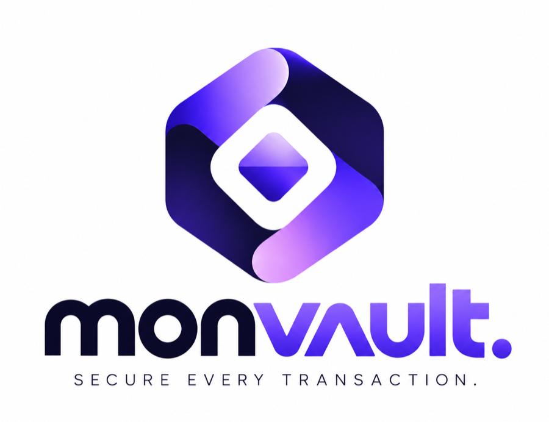
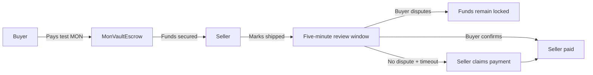
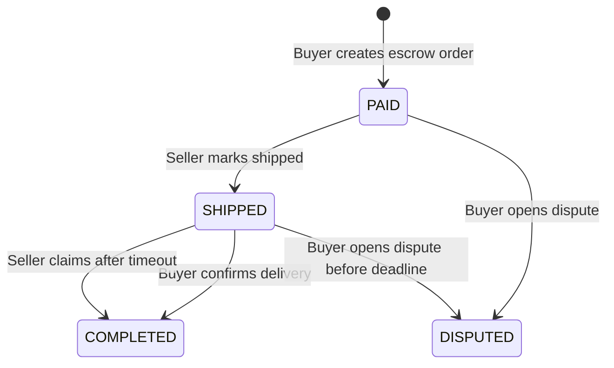
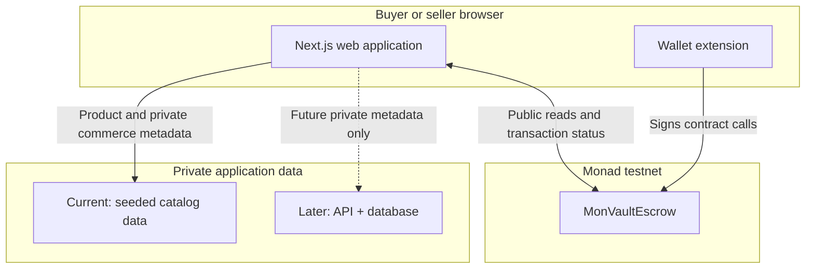

<p align="center">
  
</p>

<h1 align="center">monvault.</h1>

<p align="center">
  <strong>Delivery-protected checkout powered by Monad escrow.</strong>
</p>

<p align="center">
  A Monad testnet prototype where a buyer locks test MON in a smart contract and the seller is paid only after delivery confirmation or an undisputed review period.
</p>

<p align="center">
  <a href="#the-problem">Problem</a> ·
  <a href="#how-it-works">Flow</a> ·
  <a href="#architecture">Architecture</a> ·
  <a href="#design-system">Design</a> ·
  <a href="#getting-started">Getting started</a> ·
  <a href="docs/TESTNET-PROOF.md">Testnet proof</a> ·
  <a href="docs/DEMO-RUNBOOK.md">Demo runbook</a>
</p>

> **Testnet prototype.** monvault. uses native test MON only. It does not process real payments, independently prove physical delivery, or resolve disputes automatically.

## The problem

Online buyers usually pay before they know whether an item will arrive. The buyer must then trust a seller or marketplace to handle the money fairly.

monvault. makes the payment rule explicit and contract-enforced:

- A buyer funds an escrow order with test MON.
- A seller can see that payment is committed before shipping.
- The buyer can confirm delivery or open a dispute during a five-minute demo review window.
- If the window ends without a dispute, the seller can claim the payment.

The frontend and any future backend never custody escrow funds.

## How it works



### Contract state machine



| State | Meaning | Valid next move |
| --- | --- | --- |
| `PAID` | Funds are secured in escrow. | Seller ships; buyer may dispute. |
| `SHIPPED` | Seller started the five-minute review period. | Buyer confirms or disputes; seller can claim only after timeout. |
| `COMPLETED` | Escrow has paid the seller. | Terminal state. |
| `DISPUTED` | Funds are frozen. | Terminal state for this MVP; no arbitration is implemented. |

## What the contract enforces

`MonVaultEscrow` is the source of truth for the buyer, seller, amount, and lifecycle state of one escrow order.

- A non-zero payment creates an order with a unique opaque reference.
- Only the recorded seller can mark an order shipped.
- Only the recorded buyer can confirm delivery and release payment.
- Shipping starts a five-minute review window for the demo.
- The seller can claim only after the review window ends and only if the order is undisputed.
- A dispute freezes the funds; this MVP intentionally has no admin withdrawal, refund, or arbitration path.
- Payouts use checks-effects-interactions and a reentrancy guard.

Read the full [contract specification](docs/CONTRACT-SPEC.md) for the ABI, events, constraints, and test coverage.

## Architecture

### System boundaries



### Responsibility map

| Layer | Owns | Must not own |
| --- | --- | --- |
| **Next.js application** | Catalog presentation, cart UI, order timeline, wallet states, and transaction proof. | Escrow custody or authoritative payment state. |
| **Wallet + Monad testnet** | Signed calls to `MonVaultEscrow`; public transaction evidence. | Delivery addresses, tracking details, or customer data. |
| **`MonVaultEscrow`** | Buyer, seller, amount, order state, release rules, and payout. | Product copy, shipping evidence, or dispute arbitration. |
| **Seeded data now / private API later** | Product content and off-chain demo tracking. | Signing transactions or moving customer funds. |

### Order data model

```text
Public on-chain
├─ order ID and opaque order reference
├─ buyer and seller wallet addresses
├─ escrowed test MON amount
├─ review deadline
└─ PAID / SHIPPED / COMPLETED / DISPUTED status

Private off-chain
├─ product title, image, and display price
├─ delivery address and contact details
└─ demo tracking reference and shipment notes
```

This split keeps money rules inspectable on-chain without exposing personal delivery information. The detailed [architecture document](docs/ARCHITECTURE.md) explains the trust model and future data boundary.

## Design system

The visual direction is **“a transaction you can see.”** It turns the escrow state machine into a clear, dimensional product experience: funds enter a vault, wait under visible conditions, then resolve through confirmation, timeout, or dispute.

| Area | Direction |
| --- | --- |
| **Brand** | `monvault.` stays lowercase in product copy; supplied logo assets are never stretched, recolored, or redrawn. |
| **Typography** | Self-hosted **Inter** for hierarchy and reading; **Roboto Mono** for amounts, timers, addresses, and technical proof. |
| **Color** | Light canvas and deep ink structure with purposeful violet/lilac accents; green, amber, red, and blue communicate explicit states. |
| **Interface** | Editorial spacing, thin technical rules, clear status chips, and calm wallet actions—not a generic crypto dashboard. |
| **3D and motion** | Original solid-material escrow-vault scenes explain the flow; motion is optional, paused off-screen, and reduced for accessibility. |
| **Accessibility** | WCAG 2.2 AA contrast, visible keyboard focus, no color-only state, and `prefers-reduced-motion` support. |

**Design rules:** no new CSS gradient treatments; do not imitate Monad’s logo, layout, or visual objects; never let decorative 3D compete with a wallet action or transaction status.

[`DESIGN.md`](DESIGN.md) is the source of truth for tokens, components, page blueprints, copy boundaries, motion, responsive behavior, and acceptance criteria.

## Project status

| Area | Status | Notes |
| --- | --- | --- |
| Escrow contract | Implemented | Create, ship, confirm, dispute, and timeout-claim flows are implemented. |
| Contract tests | Implemented | Coverage includes authorization, state transitions, exact payouts, timeout boundaries, and reentrancy. |
| Web foundation | Implemented | Next.js, TypeScript, responsive landing page, approved brand assets, fonts, and seeded catalog. |
| Testnet deployment | Planned | Contract address and explorer proof follow deployment. |
| Wallet integration | Planned | `viem`/`wagmi` integration begins with checkout. |
| Commerce + seller flows | Planned | Shop, checkout, tracking, and seller operations follow the shared interface handoff. |

See [`docs/TESTNET-PROOF.md`](docs/TESTNET-PROOF.md) for public deployment evidence, [`docs/PHASES.md`](docs/PHASES.md) for delivery acceptance, and [`docs/TEAM-WORKFLOW.md`](docs/TEAM-WORKFLOW.md) for ownership boundaries.

## Repository layout

```text
apps/web/       Next.js buyer and seller experience
contracts/      Foundry project: MonVaultEscrow and Solidity tests
docs/           Product, architecture, contract, design workflow, and demo specs
assets/brand/   Approved monvault. source and working brand assets
services/api/   Reserved for private off-chain data services
_progress/      Resumable implementation checkpoints
```

## Getting started

### Prerequisites

- Node.js 20+
- npm
- [Foundry](https://book.getfoundry.sh/getting-started/installation) for Solidity testing
- A disposable MetaMask wallet and test MON only for the future testnet demo

### Install and run the web app

```bash
npm install
npm run dev
```

Open `http://localhost:3000`.

### Environment configuration

Copy the public configuration template before wallet integration or deployment:

```bash
cp .env.example .env.local
```

`NEXT_PUBLIC_*` values are visible in the browser. Never commit private keys, seed phrases, delivery addresses, or customer data.

### Verification

```bash
npm run lint
npm run typecheck
npm run build
npm run contract:test
```

`npm run contract:test` executes `forge test` from `contracts/`. Contract changes must pass their test suite before frontend integration.

## Demo acceptance checklist

Before presenting:

- [ ] Buyer and seller use separate disposable test wallets.
- [ ] Test MON is actually held by the deployed contract.
- [ ] The seller cannot withdraw before buyer confirmation or review expiry.
- [ ] A non-buyer cannot confirm delivery.
- [ ] Confirmation, timeout, and dispute paths have transaction or revert evidence in the Monad explorer.
- [ ] The UI does not claim that physical delivery was verified on-chain.

Use the [demo runbook](docs/DEMO-RUNBOOK.md) for the presentation script and fallback plan.

## Scope and limitations

monvault. is a focused, one-order escrow demonstration—not a production marketplace. It deliberately excludes real money, multi-seller carts, carrier integrations, automated refunds, dispute arbitration, production authentication, and backend transaction signing.

A buyer’s confirmation or dispute acts as the delivery oracle in this MVP. The blockchain cannot independently prove that a physical package arrived.

## Team

- **Abdullah Salik** — Solidity, wallet integration, Monad testnet deployment, and technical demo
- **Fahad Faisal** — web product flow, seeded/off-chain commerce data, responsive pages, and presentation

Read [`CONTRIBUTING.md`](CONTRIBUTING.md) before contributing. Keep PRs focused and follow the ownership rules in [`docs/TEAM-WORKFLOW.md`](docs/TEAM-WORKFLOW.md).

## License

No license has been selected for this repository yet. Do not assume permission to reuse the code or visual assets outside this project.
